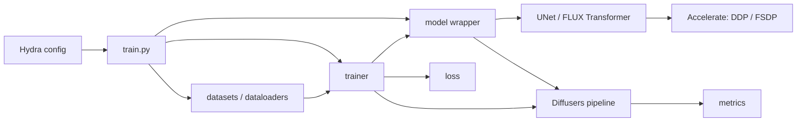

# Architecture

Этот документ — краткая карта кода для агентов, которые реализуют и отлаживают
эксперименты. Он описывает устойчивую архитектуру и основные контракты, но не
перечисляет все экспериментальные классы.

Если документация расходится с кодом, источником истины являются базовые
реализации SDXL/FLUX, `train.py` и используемый root-конфиг. Специализированные
адаптеры вроде PhotoMaker следует читать только после базовой архитектуры.

## Быстрый порядок чтения

Для большинства задач достаточно последовательно открыть:

1. `train.py` — сборка и запуск эксперимента.
2. Нужный root-конфиг в `src/configs/`, например
   `persongen_train_lora.yaml` или `flux_train_lora.yaml`.
3. `src/model/distributed.py` — общий distributed/checkpoint contract.
4. `src/model/<family>/original.py` и `lora.py` — модель и адаптер.
5. `src/trainer/base_trainer.py` и trainer нужного семейства.
6. Dataset, loss и pipeline, указанные в root-конфиге.

## Ментальная модель

`train.py` является composition root. Hydra-конфиг описывает компоненты, а
entry point создаёт их и передаёт runtime-зависимости: `Accelerator`, model,
dataloaders, optimizer и writer.

Model-wrapper (`SDXL`, `Flux` и их наследники) владеет всеми pretrained
компонентами. При распределённом обучении оборачивается не весь wrapper, а
только обучаемый diffusion backbone: `unet` для SDXL или `transformer` для
FLUX. Frozen VAE и text encoders остаются обычными модулями.

`BaseTrainer` владеет общим lifecycle обучения, валидации, логирования и
checkpoint-ов. Backend-specific trainer определяет, как обработать один train
или validation batch.



## Карта репозитория

- `train.py` — основной entry point обучения.
- `inference.py` — distributed inference по одному или нескольким checkpoint-ам;
  использует тот же prepared backbone и evaluation loop, что и validation.
- `src/configs/` — Hydra-конфиги компонентов и root-конфиги экспериментов.
- `src/model/distributed.py` — выбор distributed backbone, proxy для pipeline,
  materialization state dict и загрузка distributed state.
- `src/model/sdxl/` — базовые SDXL и SDXL LoRA.
- `src/model/flux/` — базовые FLUX и FLUX LoRA.
- `src/model/photomaker/` — специализированные SDXL-based модели.
- `src/pipelines/` — сборка inference pipeline из компонентов model-wrapper.
- `src/trainer/base_trainer.py` — общий train/evaluation/checkpoint lifecycle.
- `src/trainer/base_inferencer.py` — общий inference lifecycle.
- `src/trainer/*_trainers.py`, `*_inferencers.py` — логика семейств моделей.
- `src/datasets/` — datasets, collate-функции и создание dataloader-ов.
- `src/loss/` — objective-функции.
- `src/metrics/` — validation-метрики и их агрегация.
- `src/logger/` — Console, WandB и Comet writers.
- `src/utils/` — seed, I/O, директории ранов и вспомогательная инициализация.
- `scripts/` — воспроизводимые команды запуска экспериментов.

## Конфигурация

### Hydra experiment config

Root-конфиги находятся непосредственно в `src/configs/`. Они соединяют config
groups:

- `model`, `trainer` или `inferencer`, `pipeline`;
- `datasets`, `dataloaders`, `transforms`;
- `loss_function`, `optimizer`, `lr_scheduler`;
- `metrics`, `writer`;
- параметры конкретного эксперимента и `validation_args`.

`_target_` задаёт Python-класс или factory, создаваемый через
`hydra.utils.instantiate`. Поля root-конфига после `_self_` имеют приоритет над
подключёнными defaults.

Конфиг не является полностью самостоятельным object graph. `train.py`
дополнительно инжектирует:

- `accelerator` в model;
- trainable parameters в optimizer;
- optimizer в scheduler;
- model и accelerator в pipeline;
- все созданные компоненты в trainer.

`inference.py` аналогично инжектирует model и accelerator, готовит каждый
validation dataloader через `accelerator.prepare()` и создаёт pipeline на всех
rank-ах. Logger и writer создаются только на main process.

Схема конфигурации не типизирована через Hydra `ConfigStore`: обязательные поля
определяются конструкторами, `???`, assert-ами и соглашениями ниже.

### Accelerate launch config

Hydra-конфиг эксперимента и конфиг запуска Accelerate — разные слои.
Фактический режим DDP/FSDP задаётся аргументом
`accelerate launch --config_file=src/configs/ddp/<config>.yaml`.

Поддерево Hydra `config.ddp` не настраивает созданный в `train.py`
`Accelerator`; оно главным образом сохраняет launch metadata в итоговом
конфиге. Поэтому при отладке distributed-запуска нужно проверять и shell-скрипт,
и Hydra overrides, а не только сохранённый root-конфиг.

## Lifecycle обучения

`train.py` выполняет следующие шаги:

1. Фиксирует seed и создаёт `Accelerator`.
2. На main process создаёт директорию рана, logger и writer.
3. Создаёт datasets, dataloaders и transforms.
4. Создаёт model-wrapper и вызывает:
   `prepare_for_training()`, `load_train_base_model()` и
   `move_frozen_modules_to_device()`.
5. Создаёт loss и validation metrics.
6. Получает parameter groups через `model.get_trainable_params(config)` и
   создаёт optimizer и scheduler.
7. Передаёт в `accelerator.prepare()` только distributed backbone, train
   dataloader, optimizer и scheduler. Validation dataloaders готовятся отдельно.
8. Создаёт pipeline поверх подготовленного backbone.
9. Создаёт trainer и вызывает `trainer.train()`.

`BaseTrainer`:

- поддерживает epoch-based и iteration-based обучение;
- масштабирует batch-dependent интервалы с учётом gradient accumulation;
- запускает baseline validation перед первым train epoch;
- агрегирует validation metrics между процессами;
- выполняет периодическое сохранение и resume;
- оставляет обработку батча backend-specific trainer-у.

Logger, writer, сохранение файлов и итоговая агрегация метрик выполняются на
main process. Model forwards во время distributed validation выполняются на
всех процессах.

## Lifecycle инференса

`inference.py` повторяет distributed-часть training bootstrap: создаёт model,
оборачивает только diffusion backbone, шардирует validation dataloaders и
создаёт pipeline на каждом rank-е. `BaseInferencer` перебирает
`epochs_to_infer`; значение `0` означает базовую модель без загрузки checkpoint,
остальные значения загружают `checkpoint-epoch<N>.pth`.

Для каждого dataset используется `BaseTrainer._evaluation_epoch()`. Metrics и
logging thumbnails собираются через `gather_for_metrics()`. Тот же вызов
удаляет samples, которыми Accelerate дополняет последний distributed batch.
Каждый record содержит token физического rank/batch; только rank, чей token
остался после удаления padding, сохраняет исходные `generated` images.

Сохраняемые изображения не проходят через logging thumbnail: pipeline output
записывается напрямую с исходным разрешением. Общий `metrics.json` пишет main
process после завершения dataset.

## Контракты компонентов

### Model-wrapper

Формального `BaseModel` нет. Общий интерфейс задаётся
`SelectiveDistributedMixin` и соглашениями:

- `distributed_model_attr` — имя trainable backbone;
- `frozen_module_attrs` — модули, переносимые на device вручную;
- `prepare_for_training()` — freeze/unfreeze, adapters и dtype;
- `load_train_base_model()` — выбор train-весов, если модель их переключает;
- `get_trainable_params(config)` — parameter groups для optimizer;
- `forward(**batch)` — подготовка noisy inputs и вызов backbone;
- `get_state_dict()` / `load_state_dict_()` — portable checkpoint format.

`forward()` должен возвращать как минимум `model_pred` и `target`. Модели,
сохраняющие только адаптер, задают `checkpoint_trainable_only = True`.

### Distributed model

`SelectiveDistributedMixin` предоставляет:

- `get_distributed_model()` / `set_distributed_model()`;
- `get_unwrapped_distributed_model()` для state и атрибутов;
- `get_pipeline_distributed_model()` для Diffusers pipeline;
- выбор и materialization trainable state;
- загрузку state в DDP, FSDP1, FSDP2 или single-process model.

`DistributedModuleProxy` отдаёт pipeline атрибуты оригинального модуля
(`config`, `dtype` и другие), но forward направляет через prepared module. Нельзя
заменять его unwrapped backbone-ом после `accelerator.prepare()`: это обойдёт
DDP/FSDP и может сломать distributed validation.

### Pipeline

`src/pipelines/sdxl.py` и `src/pipelines/flux.py`:

1. создают стандартный Diffusers pipeline;
2. переиспользуют tokenizers, encoders, VAE и backbone model-wrapper-а;
3. заменяют backbone на `model.get_pipeline_distributed_model()`.

Новый pipeline должен сохранять этот паттерн, если он используется во время
distributed validation.

### Trainer

`BaseTrainer` реализует общий lifecycle. Наследник фактически обязан
реализовать:

- `process_batch(batch, train_metrics)`;
- `process_evaluation_batch(batch, eval_metrics)`;
- `_log_batch(batch_idx, batch, mode)`.

Только `_log_batch` формально помечен abstract; первые два метода являются
структурным контрактом.

Обычный train step:

1. применить batch transforms;
2. войти в `accelerator.accumulate(backbone)`;
3. вызвать `model(**batch)` и добавить output в batch;
4. вызвать `criterion(**batch)` и добавить losses;
5. выполнить backward, clipping, optimizer/scheduler step;
6. собрать и записать значения из `writer.loss_names`.

Loss обязан вернуть конечный scalar tensor под ключом `loss`.

### Data и batch

Главный интеграционный API проекта — словарь `batch`:

```text
Dataset.__getitem__
→ collate_fn
→ batch transforms
→ model.forward
→ loss
→ validation pipeline
→ metrics
```

При добавлении или переименовании ключа нужно проверить всю эту цепочку.

Текущий train `collate_fn` складывает `pixel_values` в tensor, а остальные поля
оставляет списками. `collate_fn_val` возвращает первый dataset item, поэтому
обычная validation-конфигурация рассчитана на `batch_size: 1`.

Базовый DreamBooth train batch содержит:

- `pixel_values`, `prompt`;
- `original_sizes`, `crop_top_lefts`, `target_sizes` для SDXL
  micro-conditioning.

Validation datasets дополнительно отдают поля, необходимые метрикам, например
reference images/concept и `id`. Конкретный batch contract следует проверять по
dataset, model и списку `inference_metrics` выбранного root-конфига.

### Metrics и writers

Metric реализует `BaseMetric`: `__call__(**batch)`, `to_cuda()` и `to_cpu()`.
Тяжёлые metric models переносятся на GPU только на время validation.
`MetricTracker` агрегирует scalar values.

Writer выбирается конфигом и предоставляет общий интерфейс для scalar, image,
text и file logging. `writer.loss_names` определяет train-losses, которые
trainer ожидает найти в batch.

## Семейства моделей

### SDXL

- Base: `src/model/sdxl/original.py::SDXL`.
- Distributed backbone: `unet`.
- Frozen modules: VAE и два CLIP text encoders.
- Training scheduler: DDPM; pipeline использует DDIM.
- Target: sampled noise.
- Default loss: `DiffusionLoss`.
- `SDXLTrainer` периодически обучает unconditional branch через `cfg_step`.
- `SDXLLora` замораживает UNet и добавляет PEFT LoRA.
- Portable adapter key: `lora_weights`.
- LoRA path сейчас использует root-параметр `lr_for_unet`.

### FLUX

- Base: `src/model/flux/original.py::Flux`.
- Distributed backbone: `transformer`.
- Frozen modules: VAE, CLIP и T5 encoders.
- Scheduler/objective: flow matching.
- Target: `noise - model_input`.
- Default loss: `FluxFlowMatchLoss`.
- Latents pack/unpack выполняется через helpers Diffusers `FluxPipeline`.
- `FluxLora` замораживает transformer и добавляет PEFT LoRA.
- Portable adapter key: `transformer_lora_weights`.
- Full transformer использует `lr_for_transformer`, LoRA — `lr_for_lora`.

### Специализированные адаптеры

PhotoMaker и другие экспериментальные адаптеры расширяют базовое семейство и
могут добавлять reference encoders, новые batch keys, custom loss или pipeline.
Их код не задаёт общий контракт проекта. Сначала нужно определить родительское
семейство и понять его обычный train path.

## Checkpoints и артефакты

Стандартная структура рана:

```text
saved/<writer.run_name>/
├── config.yaml
├── checkpoints/
│   ├── checkpoint-epoch<N>.pth
│   ├── checkpoint-epoch<N>-model/       # возможно для full-model FSDP
│   └── checkpoint-epoch<N>-optimizer/   # возможно для FSDP
└── metrics/
    └── validation.json
```

Обычный checkpoint содержит portable `state_dict`, raw
`model_state_dict` для distributed resume, optimizer/scheduler/scaler state,
RNG state и полный experiment config. Adapter-only модели сохраняют только
trainable backbone state; full-model FSDP может сохранять sharded directories.

- `resume_from` восстанавливает model, optimizer, scheduler, scaler, RNG и
  номер эпохи.
- `from_pretrained` загружает только model weights и не эквивалентен resume.
- Sharded full-model weights можно загрузить только при FSDP launch; portable
  single-file checkpoint загружается без FSDP, а raw `model_state_dict`
  поддерживает как обычный distributed launch, так и FSDP.

Inference artifacts сохраняются отдельно:

```text
<inferencer.exp_save_dir>/checkpoint_<N>/<dataset>/
├── <safe-prompt>__<hash>_<image-index>.jpg
└── metrics.json
```

Файлы лежат непосредственно в директории dataset. Дополнительный `id`, если он
есть в batch, включается в имя. Logging использует отдельный thumbnail 256×256
и не изменяет сохраняемое изображение.

Соглашения по именованию ранов и experiment scripts описаны в `docs/README.md`.

## Куда вносить изменения

- Diffusion/noising/conditioning math → `src/model/<family>/original.py`.
- LoRA targets, adapter initialization или portable adapter state →
  `src/model/<family>/lora.py`.
- Общая DDP/FSDP логика → `src/model/distributed.py`.
- Один train/evaluation step → backend-specific trainer.
- Эпохи, distributed validation, checkpoint/resume → `BaseTrainer`.
- Генерация изображений → `src/pipelines/` и `process_evaluation_batch`.
- Сохранение full-resolution inference outputs → `BaseInferencer`.
- Dataset fields → dataset, collate, model, loss и metrics вместе.
- Новый loss или metric → соответствующий модуль плюс config registry.
- Состав эксперимента → root Hydra config.
- Команда воспроизводимого запуска → `scripts/<writer.run_name>.sh`.

## Добавление нового компонента

Новый адаптер существующего семейства обычно требует:

1. унаследовать SDXL или FLUX model-wrapper;
2. настроить freeze/adapters в `prepare_for_training()`;
3. определить trainable parameter groups и checkpoint conversion;
4. добавить model config;
5. создавать новый trainer/pipeline только если меняется их контракт.

Новое семейство diffusion models обычно требует:

1. model-wrapper с `SelectiveDistributedMixin`;
2. pipeline wrapper, использующий prepared backbone;
3. trainer с train/evaluation batch logic;
4. loss с правильной семантикой `target`;
5. Hydra configs для model, pipeline, trainer и root experiment.

Новый dataset или metric должен быть зарегистрирован в соответствующем config
registry и выбран в root-конфиге по имени.

## Важные ограничения и соглашения

- Не передавать весь model-wrapper в `accelerator.prepare()` без пересмотра
  pipeline, frozen modules и checkpoint logic.
- Batch keys являются неформальным, но сквозным API.
- Optimizer parameter groups должны содержать `name`: он используется для
  логирования learning rate и gradient norm.
- Main-process-only объекты (`logger`, `writer`) могут быть `None` на других
  процессах.
- `BaseInferencer` не вызывает `BaseTrainer.__init__`, а вручную дублирует
  общие атрибуты. Изменения общих полей нужно синхронизировать.
- Многие dataset/model paths в конфигах зависят от окружения и обычно
  переопределяются в launch script.
- Root-config, launch script и сохранённый `config.yaml` нужно рассматривать
  вместе: часть значений может быть задана CLI overrides.
